

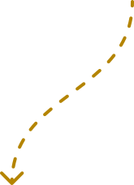

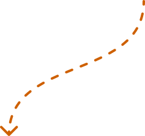

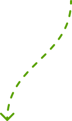

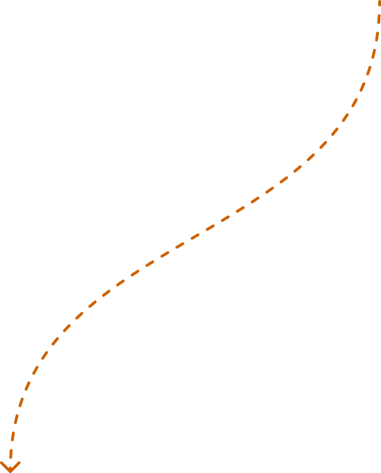

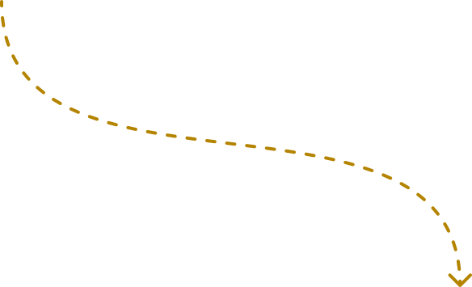

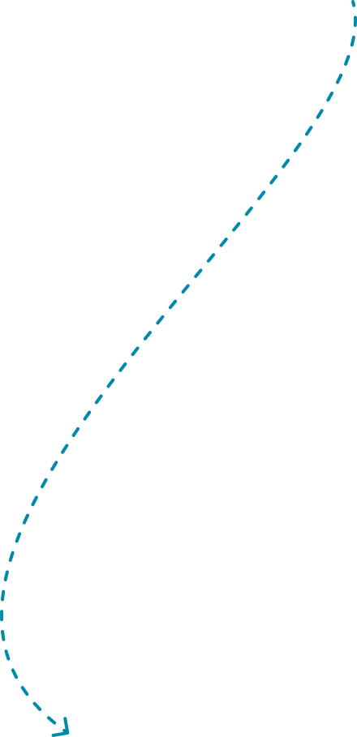

核心需求

模块化可拓展

不同可体验模块结合起来提供整体游戏体验

轻松体验

游戏从风格等整体内容体验上应当保持轻松氛围，提供解压的基调

社区型游戏

游戏从社区长出来，开发方向由玩家社区与工作室共创

提供社区参与入口

在游戏中提供玩家可以直观表达需求的方式：投票

扁平化信息架构

将玩家抵达最深页面的操作压缩到最低，简化系统

轻松化风格

将界面风格基调定轻，使用温馨的色彩风格

将关卡平铺在菜单层级

压缩信息层级至最低

一个作为游乐场的城市

将玩家包装为一个沙盒上的棋手，选择关卡就是选择城市中的一个场景

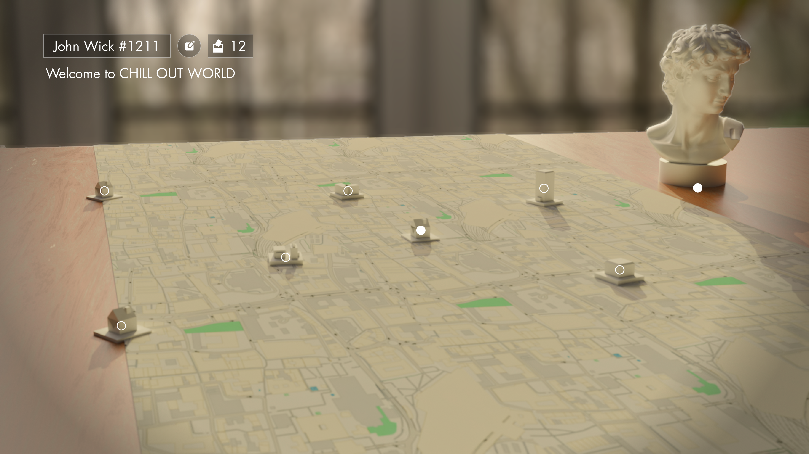

使用温馨的画面基调

使用KV进行画面定调并指导后续画面风格

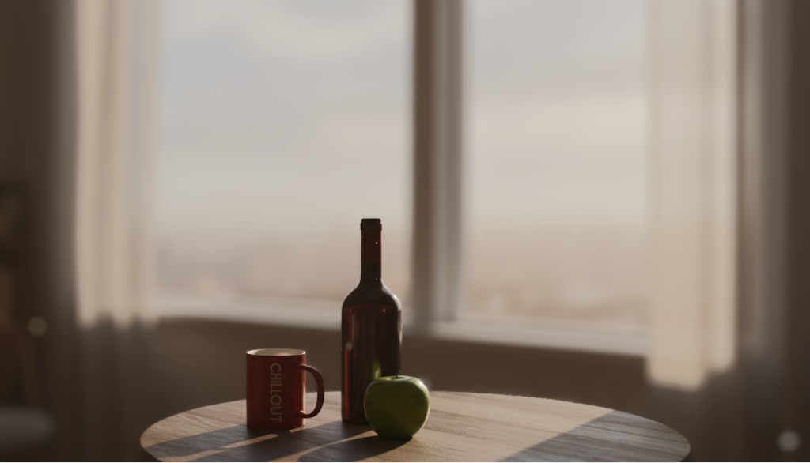

建立状态流转

归纳一套状态流转的流程，以便清晰传达给社区

归纳可体验模块

确认游戏中可体验模块的边界并传达明晰

归纳模块

将垂直切片的体验要素进行归纳

需求拆解

解决方案

低保真

高保真

该项目是一个创新型射击游戏。它的体验有别于市面上其他追求击杀的射击游戏，它希望玩家体验到物理破坏沙盒的极致解压。

​

同时，项目希望构建出共创型游戏，由玩家更多主导游戏内容的开发方向。

​

所以共创与解压，就是本项目在局外界面体验构建的核心命题。

为所有可体验模块构建一个横纵坐标，锚定其状态

1

在信息架构上压缩层级，并从高保真设计上进行叙事包装

2

在画面风格上对应核心需求

3

枪械自定义

弹药视觉效果

可破坏物品样式

局内时间体验

局内瞄准体验

游戏循环的目标

...

用户共创阶段

当一个功能想法出现时，可以第一时间投放至游戏中，与用户互动

可购买阶段(Alternative)

若这一想法被用户认可，且设定为商业化内容，则进入该阶段

可选择阶段

若这一想法被用户认可，但并非商业化内容，则直接进入该阶段，同时用户购买的商业化内容也在此阶段

可使用阶段

用户可以在游戏中对可选择阶段的内容进行配置并游玩

GUN SHOP

STAGE 2

STAGE 1

SAFE HOUSE

STAGE 3

USER NAME

VOTES

1

2

3

4

主菜单

用户名展示，后续可继续拓展其自定义功能

1

用户名修改按钮，放置在用户名展示旁

2

商业化内容展示：投票系统、货币系统

3

各类型的关卡、功能入口，其形式为放在地图桌上的沙盒小模型并辅以用户界面上的点按钮作为视觉增强，其内容包含入口名称，点图标

4

入口类型：
<ul style="list-style-type:disc"><li style="margin-bottom:0;margin-inline-start:24px">枪店(GUN SHOP)：购买枪械、装备--对应仓库页</li><li style="margin-bottom:0;margin-inline-start:24px">STAGE X：进行游玩--对应关卡选择页</li><li style="margin-inline-start:24px">SAFE HOUSE：进行游玩+装备自定义选项--对应仓库页+关卡选择页</li></ul>
<ul data-node-id="253:4913" style="word-break:break-word;position:absolute;display:block;font-family:&#x27;PuHui&#x27;,&#x27;Noto SC&#x27;,sans-serif;line-height:0;left:31.34px;list-style-type:disc;font-style:normal;font-size:0px;color:#000;top:48.39px;width:528.795px"><li style="font-family:&#x27;Noto SC&#x27;,sans-serif;font-weight:400;line-height:normal;margin-bottom:0;margin-inline-start:calc(var(--list-marker-font-size,0)*1.5*1);font-size:16px">点图标按钮状态(2种)：默认(常规菱形点)、悬浮(沙盒小模型四周高亮)</li><li style="font-family:&#x27;Noto SC&#x27;,sans-serif;font-weight:400;line-height:normal;margin-inline-start:calc(var(--list-marker-font-size,0)*1.5*1);font-size:16px">点击后跳转 02功能/关卡详情页</li></ul>

将关卡平铺在菜单层级

仓库页Inventory

归纳模块

建立状态流转

GUN SHOP

Description

PageTitle

Aaa

Description.

ClassA

aaa

ClassB

xxx

ClassC

000

aaa

bbb

ccc

ddd

eee

fff

ggg

hhh

iii

jjj

lll

The Shawshank Redemption

Schindler&#x27;s List

1

2

3

4

5

6

BUY

内容可被购买时

内容可被选择时

SELECT

玩家选择该入口后，画面将有一个拉近运镜，并将具体入口的小模型移动至左下角，同时有从下到上渐显的动画过渡打开该页面

页面左侧面板为当前入口的简介，包含内容：入口的标题、入口简要的文字简介、场景环境预览(用于模拟进入该场景的感受)

功能页标题

列表条目大类别Tab

列表条目，垂直滚动列表，有上下隐藏边界

列表详情面板，包含内容名称、描述文字、内容图片展示(提供选择这一内容的模拟感受)，在右下角可以根据当前内容的状态配置不同的功能按钮

1

2

3

4

5

5

<ul data-node-id="253:5091" style="word-break:break-word;position:absolute;display:block;font-family:&#x27;Noto SC&#x27;,sans-serif;font-weight:400;line-height:0;left:31.57px;list-style-type:disc;font-size:16px;color:#000;top:197.07px;width:532.427px"><li style="margin-bottom:0;margin-inline-start:24px">条目状态(4种)：已选中(图中aaa),可选择(bbb),待购买(eee),待投票(fff)</li><li style="margin-inline-start:24px">条目按钮状态(3种)：默认、悬浮、选中</li></ul>

选中

悬浮

VOTE

内容需要被投票时

内容需要被投票时

默认

关卡选择页Mode

3

GUN SHOP

Description

PageTitle

Mode A(Sub)

Mode B(Primary)

Mode Name

Mode Description

1

Difficulty Level Selection(If Have)

Mode Name

Mode Description

PLAY

4

5

6

2

1

1

2

3

4

5

同仓库页设计

主模式与副模式选择面板，为水平滚动列表，有左右隐藏边界，模式条目的状态也与仓库页一致

详情面板大致与仓库页一致，左下角添加次级入口用于打开全屏详情页，用于再详细介绍与展示当前模式具体信息

归纳模块

建立状态流转

尝试1

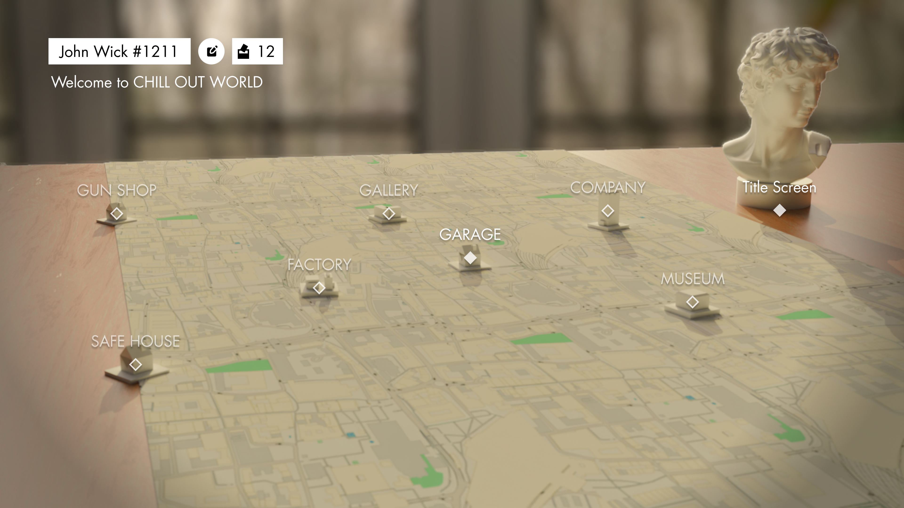

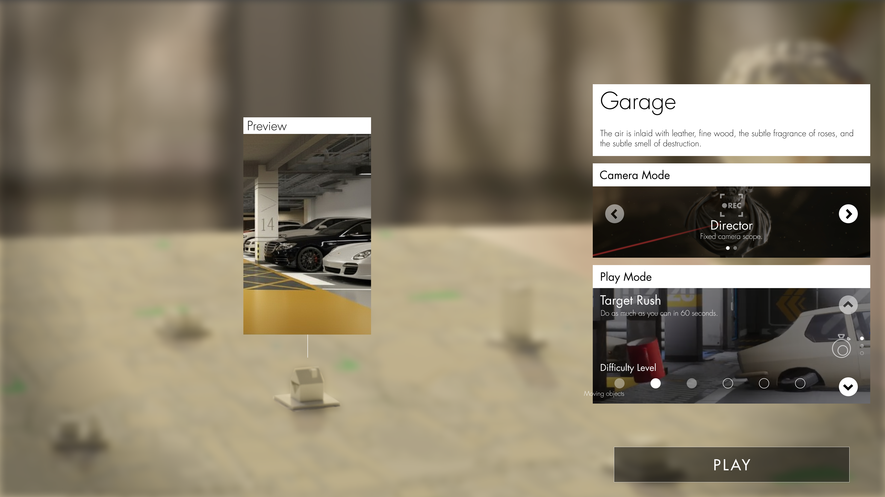

尝试2

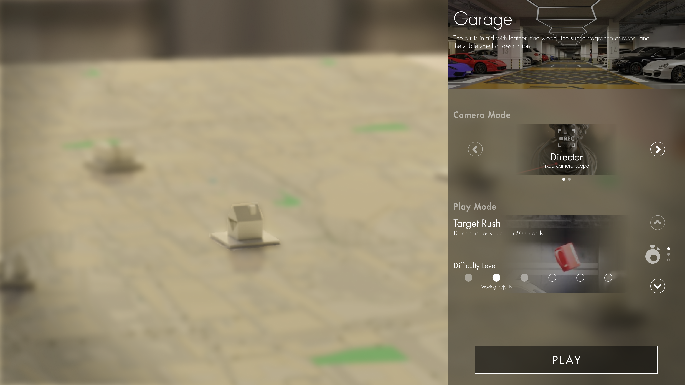

尝试3

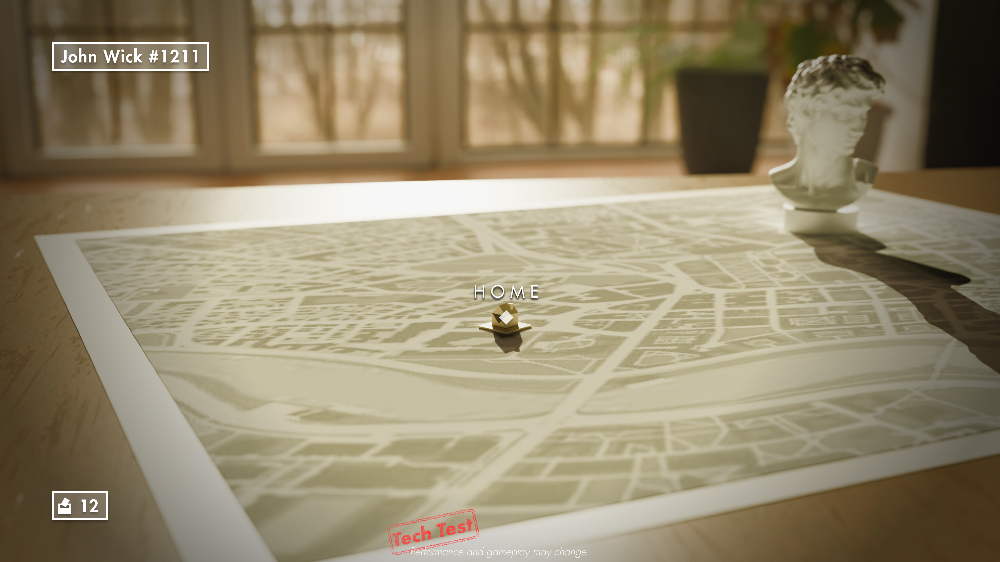

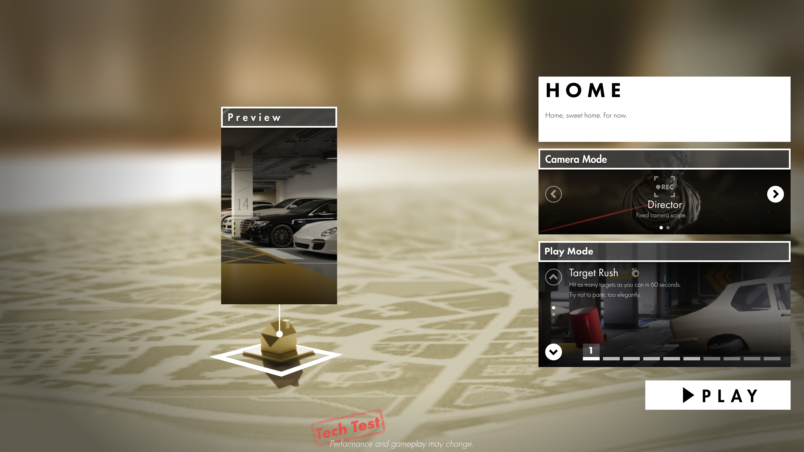

将关卡平铺在菜单层级

压缩信息层级至最低

一个作为游乐场的城市

将玩家包装为一个沙盒上的棋手，选择关卡就是选择城市中的一个场景

使用温馨的画面基调

使用KV进行画面定调并指导后续画面风格

建立状态流转

归纳一套状态流转的流程，以便清晰传达给社区

归纳模块

将垂直切片的体验要素进行归纳

解决方案

为所有可体验模块构建一个横纵坐标，锚定其状态

1

在信息架构上压缩层级，并从高保真设计上进行叙事包装

2

在画面风格上对应核心需求

3

枪械自定义

弹药视觉效果

可破坏物品样式

局内时间体验

局内瞄准体验

游戏循环的目标

...

用户共创阶段

当一个功能想法出现时，可以第一时间投放至游戏中，与用户互动

可购买阶段(Alternative)

若这一想法被用户认可，且设定为商业化内容，则进入该阶段

可选择阶段

若这一想法被用户认可，但并非商业化内容，则直接进入该阶段，同时用户购买的商业化内容也在此阶段

可使用阶段

用户可以在游戏中对可选择阶段的内容进行配置并游玩

