

<section class="mel-body-frame" data-slide-label="项目概述" data-design-width="1920" data-design-height="1080">

科幻

双主角

合作

最终设定为一个科幻故事，女主Mel由于失去自己的丈夫Kelvin而出现精神疾病，而他们共同所在的实验室同僚为了挽救Mel为其设计了一系列的谜题实验室，并通过技术手段让她和她记忆中的Kelvin一起在两个世界中闯关，最终Mel找回记忆并最终康复。

项目简介

设定

玩法

技术

游戏核心玩法为横板跳跃+表里世界切换，并在关卡中架设推箱子、压力开关、陷阱等元素组成谜题。游戏进程则由各个独立关卡组成，并通过穿插其中的碎片化叙事将设定抛出。

游戏使用Unity 2D进行开发，并通过像素绘画软件Aseprite进行游戏中所有的画面素材绘制。

治愈

温馨结局

动作解谜

Unity 2D

Aseprite逐帧动画

横板跳跃

表里切换

游戏创作挑战命题

创作挑战题目为&quot;Take me somewhere nice&quot;或“一起漫游”，通过题目我们提取出了【合作】、【经历】等关键词，并决定开发一款双主角的横板闯关解谜游戏。

项目概述

</section>
<section class="mel-body-frame" data-slide-label="系统设计" data-design-width="1920" data-design-height="1080">

系统设计


</section>
<section class="mel-body-frame" data-slide-label="核心游戏循环" data-design-width="1920" data-design-height="1080">

核心游戏循环

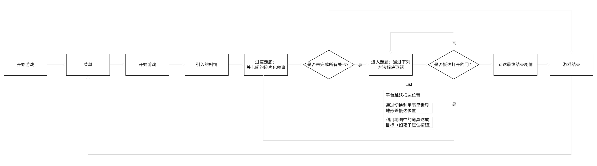

</section>
<section class="mel-body-frame" data-slide-label="信息设计" data-design-width="1920" data-design-height="1080">

信息设计


</section>
<section class="project-long-slide mel-showcase" data-slide-label="主要画面展示">
<section class="mel-body-frame" data-slide-label="局外画面" data-design-width="1920" data-design-height="1080" data-crop-top="80" data-crop-bottom="830">

主要画面展示

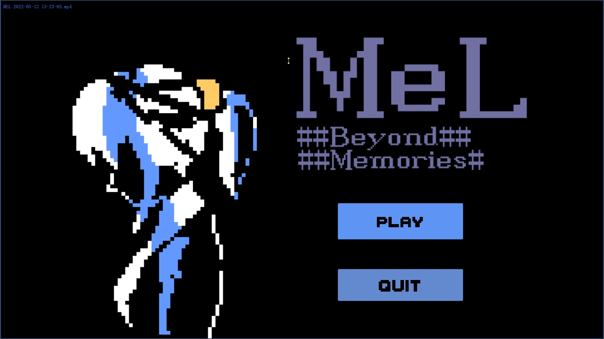

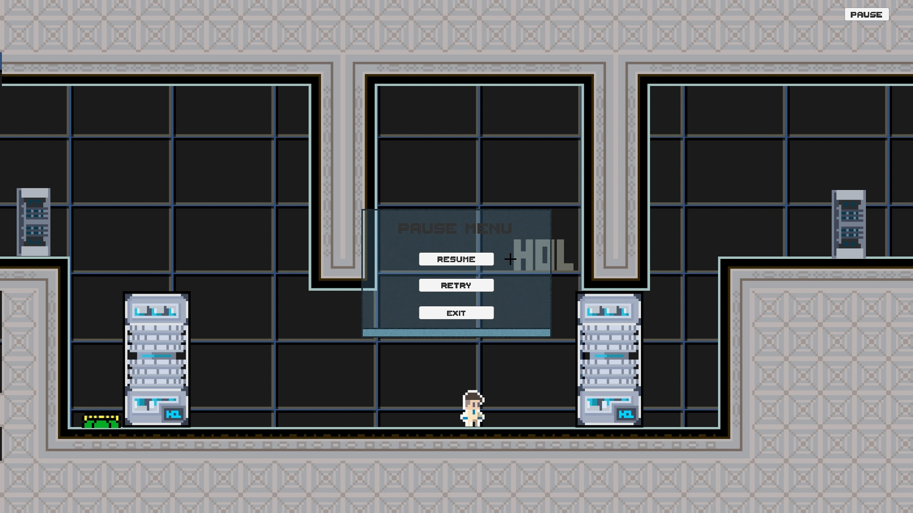

局外界面

主菜单

Esc菜单

符合科幻主题的GUI设计

</section>

<section class="mel-body-frame" data-slide-label="局内画面：玩家体验" data-design-width="1920" data-design-height="1080" data-crop-top="180" data-crop-bottom="830">

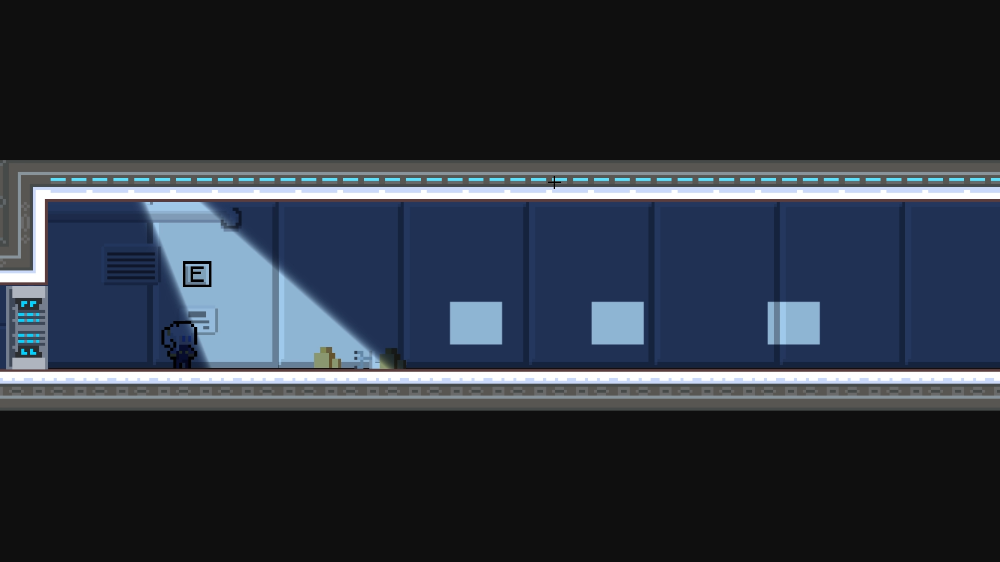

局内界面-玩家体验部分

交互提示

局内摄像机：全局展示

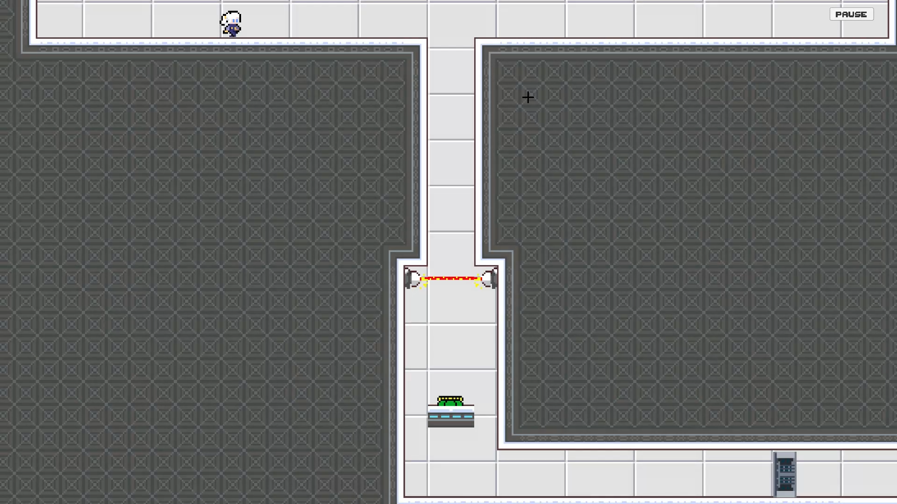

隐藏除交互提示外的HUD进而提升代入感，通过根据关卡大小动态调整摄像机画幅，提供全局的信息展示

</section>

<section class="mel-body-frame" data-slide-label="局内画面：关卡信息与道具" data-design-width="1920" data-design-height="1080" data-crop-top="180" data-crop-bottom="840">

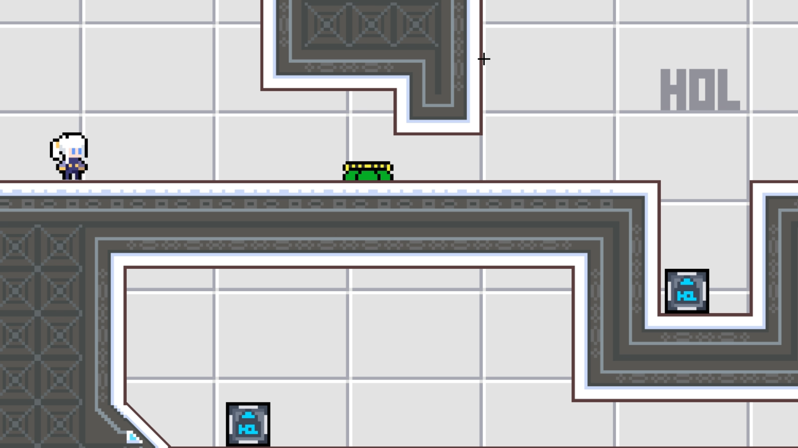

局内界面-关卡信息部分

通过高饱和度道具与低饱和度关卡产生对比，突出关键信息和道具

关键信息和道具

道具设计

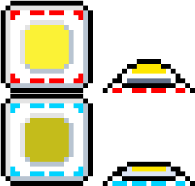

按钮

跳板

不同尺寸的箱子

关卡目标门

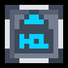

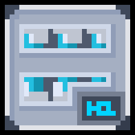

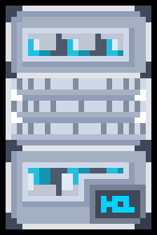

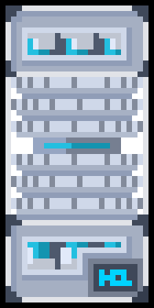

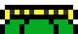

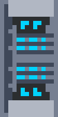

</section>

<section class="mel-body-frame" data-slide-label="表里世界反色设计" data-design-width="1920" data-design-height="1080" data-crop-top="180" data-crop-bottom="840">

局内界面-关卡信息部分

表里世界反色设计

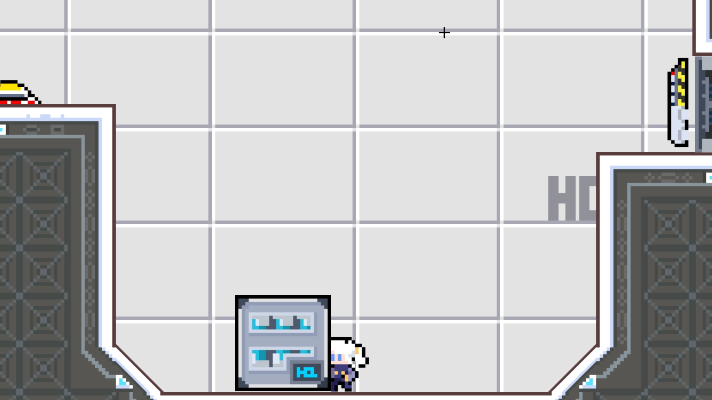

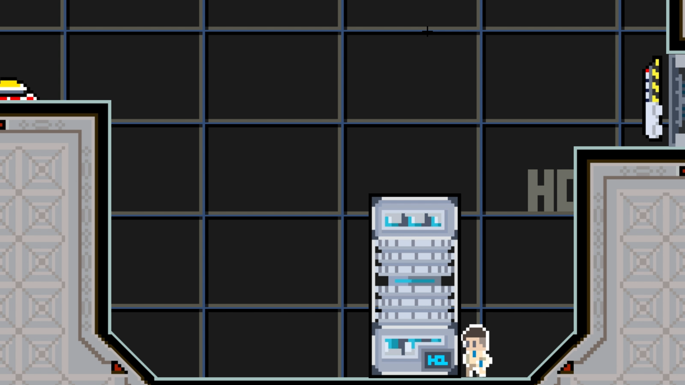

通过反色设计使关卡两层产生鲜明对比

</section>

<section class="mel-body-frame" data-slide-label="剧情演出" data-design-width="1920" data-design-height="1080" data-crop-top="180" data-crop-bottom="985">

局内界面-剧情部分

关卡式剧情演出

关卡式剧情演出

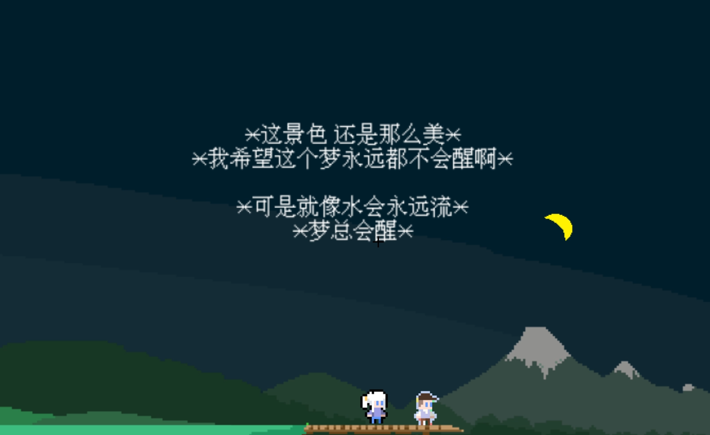

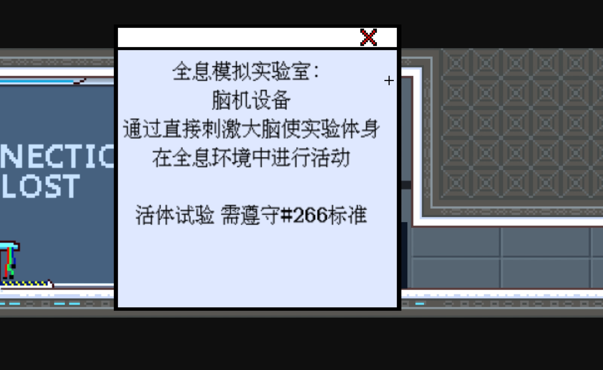

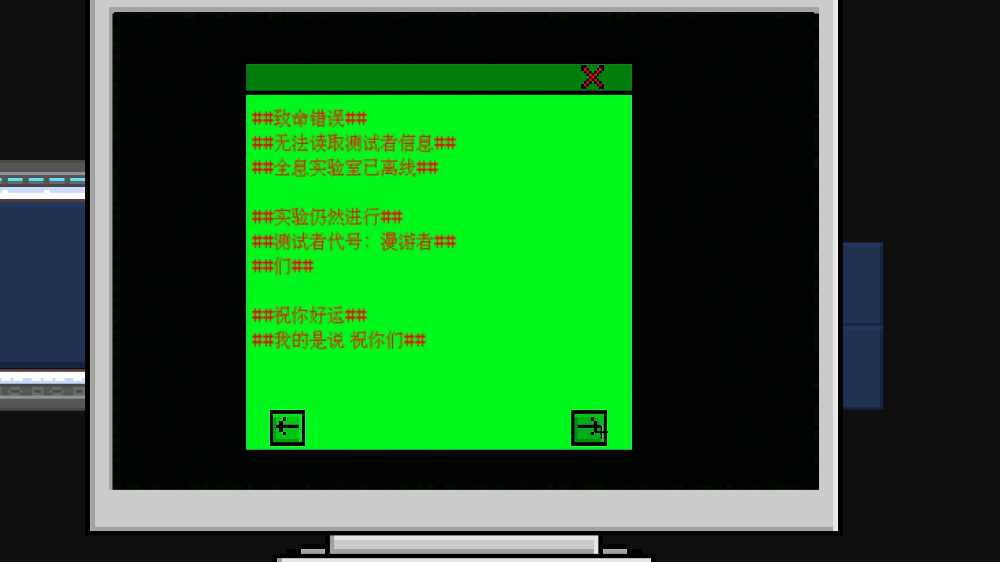

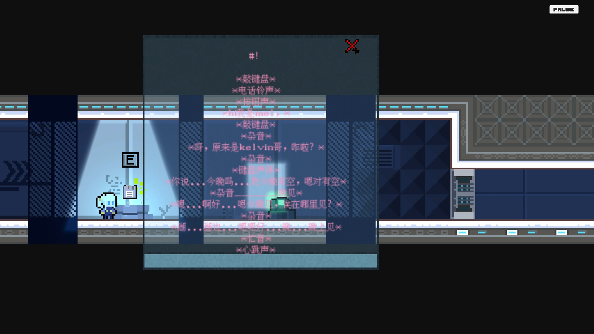

关卡式可互动的剧情演出，增强代入感；在关卡间的可交互物品的碎片化叙事，通过不同的GUI设计提供不同的情绪

</section>
</section>

