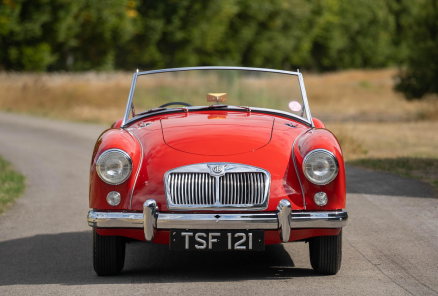
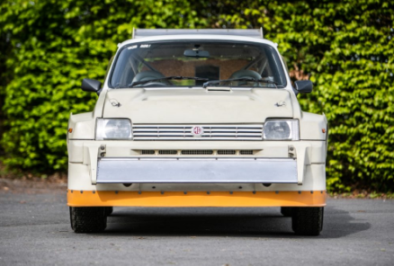
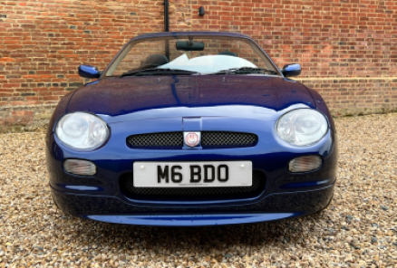
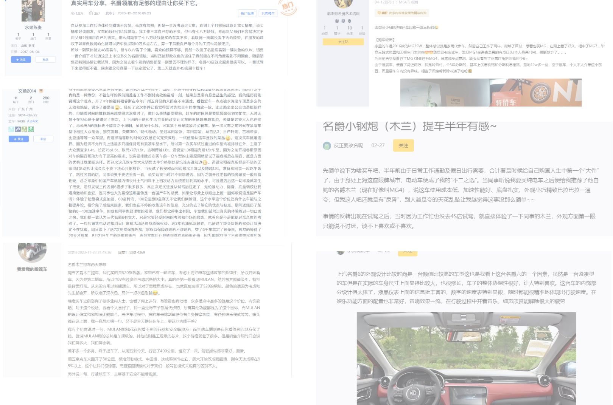
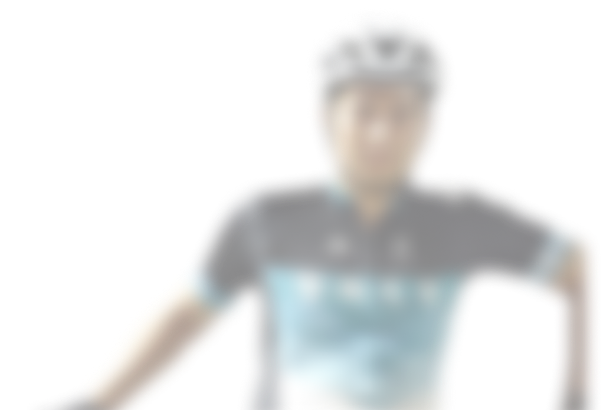
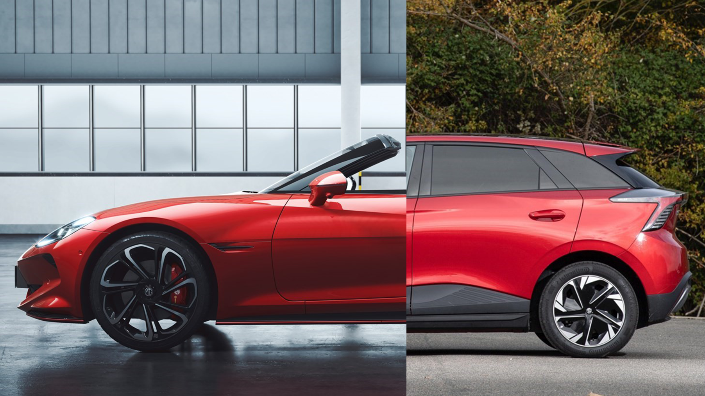
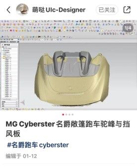

<section class="saic-body-frame" data-slide-label="SAIC 第 1 页" data-design-width="1920" data-design-height="1080">

项目概述

策略与传达赛道命题

设计方法与目标-  MG 100年全新品牌战略

曾有数码博主称，中国汽车市场的特点是“车坐不开”，中国消费者的归宿一定是SUV和方盒子MPV；也有人坚信，激发人类本能的汽车运动文化将延续下去。 

同质化的“冰箱彩电沙发”和感性的速度之美如何平衡？ 品牌基因与新技术、新需求是什么关系？100岁的MG品牌正在展望下一个时代方向。 请结合自己生活中的真实案例，如长辈们的真实用车需求、同龄年轻人对车的真实态度等，谈一谈你对未 来5年中国乃至全球汽车生活形态的想法，并为MG品牌提出合适的发展策略，包括但不限于： 

1、品牌策略：未来的MG品牌能为用户提供什么价值？.... 

2、产品策略：MG全球化产品型谱、产品核心亮点... 

3、造型策略：未来MG设计的风格方向、智能座舱体验策略

通过综合市场情况、用户画像、品牌历史为MG指定新的品牌策略，包括品牌形象塑造，产品线布局

品牌策略

产品线布局

品牌形象

措施

方法

目标

品牌历史分析

01

利用【设计框架思维】分析品牌历史形象

市场状况分析

02

宏观数据分析，定位合适的用户群体

用户画像洞察

03

使用【用户研究方法】洞察用户群体画像

</section>
<section class="saic-body-frame" data-slide-label="SAIC 第 2 页" data-design-width="1920" data-design-height="1080">

品牌历史分析

方法：设计框架思维

名爵品牌历史分析

复杂设计系统的系统性解释方法,通过对设计目标、解决方法、设计成果进行解释与定义，形成逻辑闭环的框架系统

WHAT

HOW

VALUE

具体问题

解决方法

产生的额外价值

框架构建

FRAME

设计需要解决的具体问题

WHAT

解决问题的方法

HOW

设计解决问题后产生的额外价值

VALUE

方法与额外价值中产生的逻辑框架

FRAME

标志性车型

WHAT

HOW

FRAME

VALUE

MGA

MG Metro

MGF

满足英国乡村间的交通需求

成本控制

与马自达MX-5竞争

参加赛事

运动底盘

小体积

开放式座舱

个性

灵动

驾驶体验

操控带来乐趣

乐趣制造机

01

</section>
<section class="saic-body-frame" data-slide-label="SAIC 第 3 页" data-design-width="1920" data-design-height="1080">

市场状况分析

02

名爵当前的市场反馈

从销售数据、网络平台等渠道调研名爵的用户群

关键词

年轻群体

运动感

预算敏感

表现自我

宏观分析下，名爵的目标用户多为愿意表现自我，希望车辆能够有一定运动表现的，且口袋里并没有充足预算的年轻群体。

</section>
<section class="saic-body-frame" data-slide-label="SAIC 第 4 页" data-design-width="1920" data-design-height="1080">

抽样半结构化访谈

使用定性的半结构访谈对年轻群体进行抽样

用户画像洞察

03

用户背调

核心观点

在读理科博士

财政状态优秀

刚刚接触汽车

篮球爱好者

在读工科硕士

财政状态优秀

音乐爱好者

在读医科硕士

财政状态优秀

骑行爱好者

游戏爱好者

都来自广州（一线城市）

拥有驾驶经验

共同点

理性消费

实用主义

时间碎片化

独特但不怪异

“我在广州我就会选电车，我在美国就会选油车。”

“既能买菜，也能去开各种各样，就能胜任各种各样条件非常实用的车型，这可能是我的第一想法。”

“但是我觉得更主要还是，（我的）个人时间也被工作碎片化了。”

“如果大家都穿黑鞋，那我觉得可能穿白鞋是一个不错的选项。它没那么沉稳，但是如果你要我穿荧光绿或者骚粉，我就觉得有点太过了。”

</section>
<section class="saic-body-frame" data-slide-label="SAIC 第 5 页" data-design-width="1920" data-design-height="1080">

质化编码并定位痛点

基于观点进行整合，产出用户画像

被现实与个性夹在中间。

用户画像洞察

03

夹心饼

很多的想法

很多的负担

拥有爱好

追求独特

拥有冲劲

压力渐增

选择受限

</section>
<section class="saic-body-frame" data-slide-label="SAIC 第 6 页" data-design-width="1920" data-design-height="1080">

确立品牌价值（顶层建筑）

名爵将衍化曾经对乐趣的追求，作为一颗新时代年轻人的回春丹，注入能量，将他们从“夹心饼”状态中救出

策略提出

夹心饼

成为年轻人的回春丹

衍化曾经的乐趣

带回年轻能量

1

2

曾经的乐趣是对运动化，外观个性的追求。但当下需求的调整要求乐趣也进行“衍化”——衍生延展，出现变化。

让品牌带来的乐趣能够让年轻人重新成为年轻人

</section>
<section class="saic-body-frame" data-slide-label="SAIC 第 7 页" data-design-width="1920" data-design-height="1080">

解决用户痛点 提出品牌策略

利用【设计框架思维】使用户痛点（WHAT），解决方式（HOW），逻辑链接（FRAME），耦合“回春丹”这一新的品牌价值（VALUE）

策略提出

WHAT

HOW

FRAME

VALUE

乐于为

乐于驶

乐于依

社群共创

更多的自定义选项

每车独一无二的配件

乐于成为MG车主

乐于驾驶MG

乐于将MG融入生活

跨界车型

优化服务

降低使用成本

全新品牌策略

成为年轻人的回春丹

衍化曾经的乐趣

带回年轻能量

夹心饼

爱好与追求

现实的压力

</section>
<section class="saic-body-frame" data-slide-label="SAIC 第 8 页" data-design-width="1920" data-design-height="1080">

乐于为：社群共创 &amp; One Of配件

乐于驶：年轻向跨界车型

乐于依：更性价比的服务

具体措施

官方牵头建立社群，并通过3D打印技术提供个性配件服务，提升车主群体的身份认同

提供更加年轻化的跨界车型策略，如Hatchback+Roadster，以此吸引年轻用户将MG汽车开向不同的场景中

提供面向年轻人的轻资产服务策略，提升年轻人的购车意愿和使用官方服务的意愿

</section>

