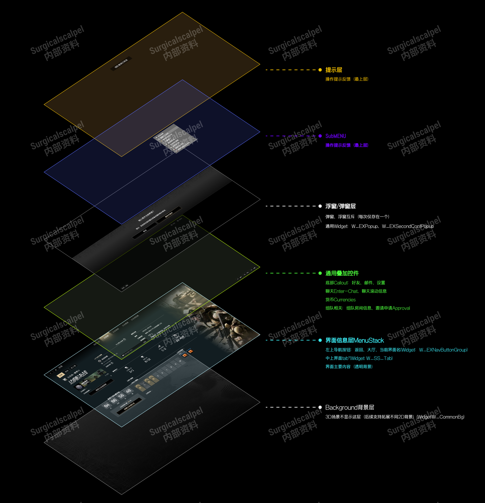
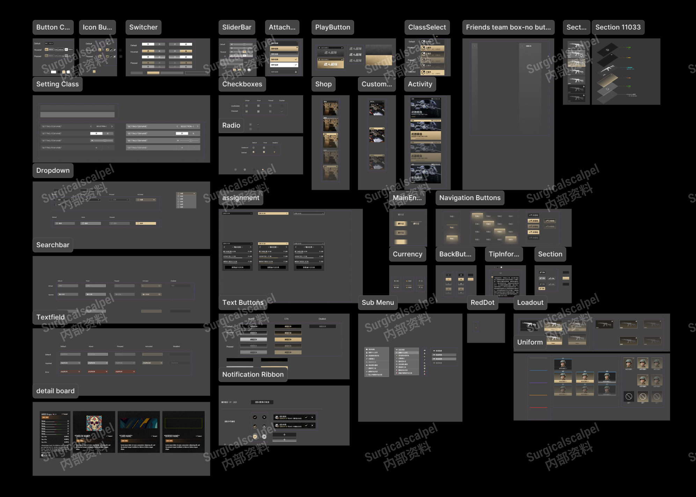
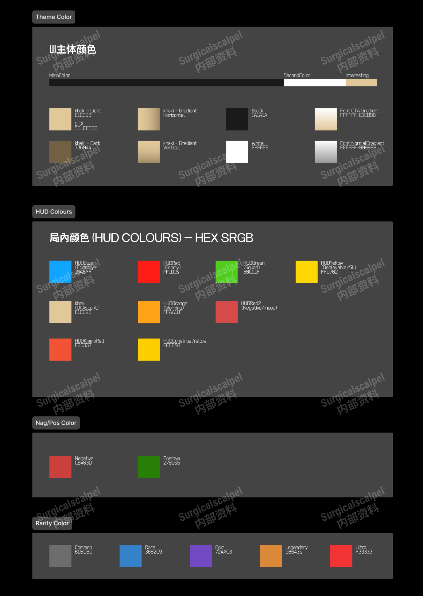
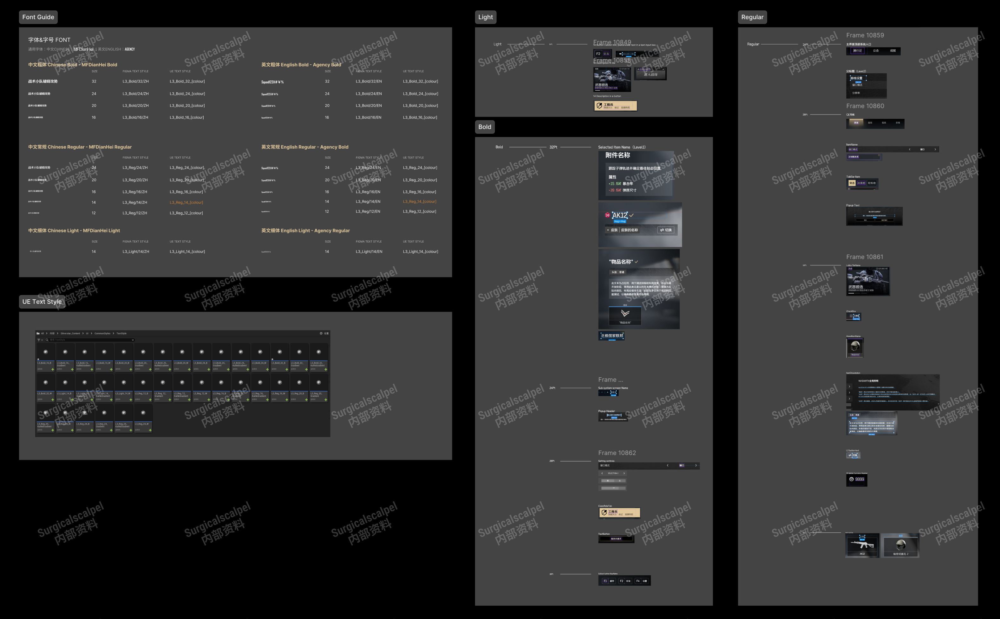
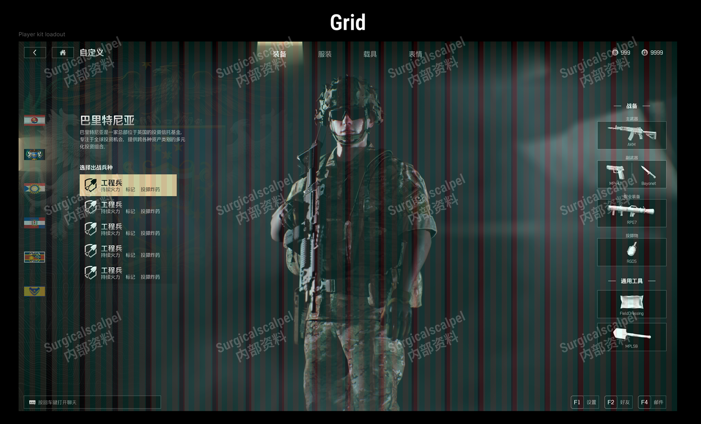
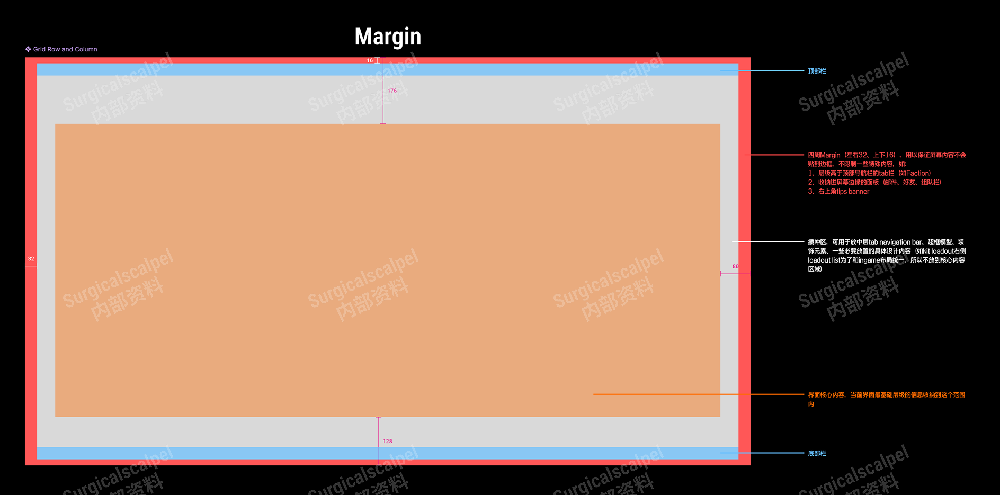
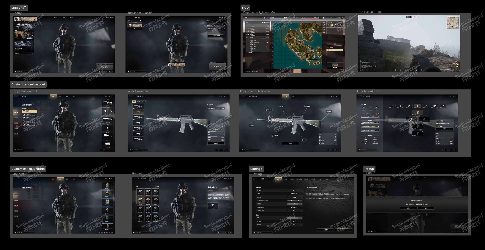

<section class="ss-editorial-page ss-overview" data-slide-label="项目概述">

SS / 项目概述
<h2>在研 2A 硬核射击游戏</h2>

部分内容仍涉密，故仅作部分展示。 本人负责了以下职责：

01<h3>迭代与维护 Figma 组件库</h3>

02<h3>负责全功能 UI 风格的设计迭代</h3>

03<h3>参与制定全流程 UIUX 的设计规范与开发规范</h3>

04<h3>UE5 引擎内 UMG 重构与前端功能对接</h3>

</section>
<section class="ss-editorial-page " data-slide-label="规范与组件库">

工作 01
<h2>规范制定 &amp; 组件库维护</h2>

<h3>对应</h3>
层级规范组件库UI颜色规范文字规范网格规范安全框规范

</section>
<section class="ss-editorial-page " data-slide-label="高保真设计">

工作 02
<h2>高保真设计</h2>

本人参与设计了
<h3>局外功能</h3><ul><li>好友系统</li><li>邮箱系统</li><li>自定义系统 <small>武器自定义、外观自定义</small></li><li>商业化 <small>战斗通行证、武器皮肤系统</small></li><li>组队系统</li></ul><h3>局内功能</h3>
部署界面 · 结算页面

<figure></figure>

</section>
<section class="ss-editorial-page " data-slide-label="邮箱 UX 需求与思路">

交互设计工作案例
<h2>邮箱系统：从核心需求到 UX 设计</h2>

<h3>核心需求</h3><dl>
<dt>接收通知</dt><dd>使玩家能接收到来自运营从后端发出的相关通知的阅读提醒以及其具体通知内容</dd>

<dt>接收奖励</dt><dd>使玩家能够接收到来自运营从后端分发的道具、材料、代币奖励</dd>

<dt>批量处理</dt><dd>使玩家能够快捷地处理大量未处理的信息与待领取奖励</dd>

<dt>限时清理</dt><dd>后端存储空间有限，邮件将有有效期，玩家需要即时收到提醒并将其处理</dd>
</dl>

<h3>UX 设计思路</h3><dl>
<dt>信息设计</dt><dd>邮件内容：文字与信息（发送时间、来源、有效期）、奖励 邮件分类：纯文字、文字 + 奖励 邮件状态：未读（未领取）、已读未领取、已读已领取</dd>

<dt>交互操作</dt><dd>阅读 · 领取 · 删除</dd>

<dt>调用系统</dt><dd>领取物品弹窗：获取物品的确认流程 红点系统：提醒 飘窗系统：交互反馈</dd>
</dl>

</section>
<section class="ss-restored-lowfi" data-slide-label="邮箱低保真 1" data-design-width="1920" data-design-height="1080">

交互设计工作案例

低保真设计

01 默认布局-有邮件但未选中邮件

根据设计转化落实至UX中，由于涉及涉密内容，只可展示低保真设计稿

在侧拉打开后添加背景模糊效果，让侧拉更为突出，同时可以点击模糊处可以快速离开侧拉

在默认状态下，没有邮件被选中，右边内容栏是一张空状态占位图

列表下方批量操作按钮

Callout Button：可以点击退出侧拉，可以按快捷键退出侧拉

页面标题旁有数字绑定，代表有多少未读邮件，同时有不计数红点在右上方增强视觉感知
<ul data-node-id="263:2359" style="word-break:break-word;position:absolute;display:block;font-family:&#x27;PuHui&#x27;,&#x27;Noto SC&#x27;,sans-serif;line-height:0;left:1204px;list-style-type:disc;font-style:normal;color:#B48400;font-size:16px;top:716px;width:616px;font-weight:700"><li style="margin-bottom:0;margin-inline-start:24px;">状态图标(4种)：未读(纯文本)、未读未领取(带奖励)、已读未领取、已读已领取</li><li style="margin-inline-start:24px;">邮件按钮状态(3种)：默认、悬浮、选中</li></ul><ul data-node-id="263:2360" style="word-break:break-word;position:absolute;display:block;font-family:&#x27;PuHui&#x27;,&#x27;Noto SC&#x27;,sans-serif;line-height:0;left:1204px;list-style-type:disc;font-style:normal;font-size:16px;color:#171713;top:832px;width:616px;font-weight:400"><li style="margin-bottom:0;margin-inline-start:24px;">全部已读并领取：将【全部已读】和【领取】融合为一个按钮，可以快速清除2种未读状态</li><li style="margin-inline-start:24px;">删除已读：提供快速将在最终状态【已读已领取】的无用邮件快速清除</li></ul>
面板左侧为滚动列表，上下有隐藏的边界，邮件按钮为列表单位，由状态图标、邮件标题、发件人、有效期提示组成；滚动条：滚轮可滚动，鼠标可拖动
<ul data-node-id="263:2362" style="word-break:break-word;position:absolute;display:block;font-family:&#x27;PuHui&#x27;,&#x27;Noto SC&#x27;,sans-serif;line-height:0;left:1164px;font-style:normal;font-size:20px;color:#171713;top:429px;white-space:nowrap;font-weight:400"><li style="list-style-type:disc;margin-inline-start:30px;">主菜单底部入口</li></ul><ul data-node-id="263:2363" style="word-break:break-word;position:absolute;display:block;font-family:&#x27;PuHui&#x27;,&#x27;Noto SC&#x27;,sans-serif;line-height:0;left:1460px;font-style:normal;font-size:20px;color:#171713;top:429px;white-space:nowrap;font-weight:400"><li style="list-style-type:disc;margin-inline-start:30px;">从右侧渐显滑入的侧拉面板</li></ul><ul data-node-id="263:2364" style="word-break:break-word;position:absolute;display:block;font-family:&#x27;PuHui&#x27;,&#x27;Noto SC&#x27;,sans-serif;line-height:0;left:1332px;font-style:normal;font-size:20px;color:#171713;top:429px;white-space:nowrap;font-weight:400"><li style="list-style-type:disc;margin-inline-start:30px;">快捷键</li></ul>
打开交互

设计说明

设计说明

界面进入形式

Esc

邮件标题

发件人

3天后过期

邮件标题

发件人

3天后过期

邮件标题

发件人

3天后过期

邮件标题

发件人

3天后过期

邮件标题

发件人

3天后过期

邮件标题

发件人

3天后过期

邮件标题

发件人

3天后过期

邮件标题

发件人

3天后过期

邮件标题

发件人

3天后过期

邮件标题

发件人

3天后过期

邮件标题

发件人

3天后过期

邮箱

(6)

全部已读并领取

删除已读

1

2

3

4

5

7

6

1

3

4

5

7

2

全部邮件已读并领取

全部邮件已读并领取

全部已读邮件已删除

飘字位置与内容：居中偏上

6

</section>
<section class="ss-restored-lowfi" data-slide-label="邮箱低保真 2" data-design-width="1920" data-design-height="1080">

交互设计工作案例

02 选中显示内容布局-选中纯文本邮件

设计说明

1

2

3

4

Esc

邮件标题

发件人

3天后过期

邮件标题

发件人

3天后过期

邮件标题

发件人

3天后过期

邮件标题

发件人

3天后过期

邮件标题

发件人

3天后过期

邮件标题

发件人

3天后过期

邮件标题

发件人

3天后过期

邮件标题

发件人

3天后过期

邮件标题

发件人

3天后过期

邮件标题

发件人

3天后过期

邮件标题

发件人

3天后过期

邮箱

(5)

全部已读并领取

删除已读

邮件标题

发件人

3天后过期

2025-05-22 14:43

亲爱的特工【代号：流光】：

我们收到来自你所在前线区域的最新传输数据。经过分析，你在“回响事件·南段”中的表现远超预期，不仅成功遏制了目标体的异常扩散，还协助情报组回收了关键样本——编号#E-702“心智碎片”。指挥中心高度评价你的决策力与现场应变能力，特此向你致以谢意。

但战斗仍未结束。根据“裂隙监测网”实时反馈，第七区域出现了新的异常波动，频率与上次事件极为相似，甚至更为活跃。情报显示，代号“灰烬协议”的敌对组织可能已掌握某种方式，能够诱发环境扰动与集体幻觉。我们怀疑这与“原核残响”技术泄露有关，当前情报等级为S级，需你立即归档确认，并准备进入下一阶段的潜入式调查任务。

但战斗仍未结束。根据“裂隙监测网”实时反馈，第七区域出现了新的异常波动，频率与上次事件极为相似，甚至更为活跃。情报显示，代号“灰烬协议”的敌对组织可能已掌握某种方式，能够诱发环境扰动与集体幻觉。我们怀疑这与“原核残响”技术泄露有关，当前情报等级为S级，需你立即归档确认，并准备进入下一阶段的潜入式调查任务。但战斗仍未结束。根据“裂隙监测网”实时反馈，第七区域出现了新的异常波动，频率与上次事件极为相似，甚至更为活跃。情报显示，代号“灰烬协议”的敌对组织可能已掌握某种方式，能够诱发环境扰动与集体幻觉。我们怀疑这与“原核残响”技术泄露有关，当前情报等级为S级，需你立即归档确认，并准备进入下一阶段的潜入式调查任务。

你将在12小时内接收到一份带有深度伪装的联络请求，该请求将引导你与失联多时的前线专家“Vera博士”取得联系。请注意，该过程可能会引发短时间的神经干扰与记忆闪回，建议提前服用“理智稳定剂-L5”以规避异常波动。

与此同时，联盟已为你解锁以下精英级补给，供你即刻提取：

脉冲反应装甲（试作型） ×1

能量维持胶囊 ×10

战术插件：环境映射扫描仪（EMSI） ×1

强化记忆缓存装置 ×1（限时7日）

所有物资已存入你在【第九中转站】的个人装备仓。若需远程配送，请输入指令【快递代码：Z9-SHADOW】以安排无人机投递。

请谨记：你并非孤军奋战。尽管整个世界似乎正在沉入混沌，联盟仍在黑暗中寻找那道微弱却不灭的光。而你，正是我们最可信赖的火种携带者。

祝你一切顺利，特工。

—— 联盟指挥中心 敬上 “燃烧自己，照亮失落的未来。”

1

2

3

4

点击邮件按钮，右侧空状态切换为选中状态，带有动态纹理，增强选中视觉感知

邮件标题栏与正文面板通过分隔线隔开，标题栏内容包括：标题、发件人、有效期、邮件发送具体时间戳

正文面板为滚动面板，上下有隐藏的边界；滚动条：滚轮可滚动，鼠标可拖动

右侧内容面板与左侧列表面板的边界上下两端对齐，内容面板再往里Padding一圈出血线

</section>
<section class="ss-restored-lowfi" data-slide-label="邮箱低保真 3" data-design-width="1920" data-design-height="1080">

交互设计工作案例

03 选中显示内容布局-选中带奖励邮件

设计说明

1

2

Esc

邮件标题

发件人

3天后过期

邮件标题

发件人

3天后过期

邮件标题

发件人

3天后过期

邮件标题

发件人

3天后过期

邮件标题

发件人

3天后过期

邮件标题

发件人

3天后过期

邮件标题

发件人

3天后过期

邮件标题

发件人

3天后过期

邮件标题

发件人

3天后过期

邮件标题

发件人

3天后过期

邮件标题

发件人

3天后过期

邮箱

(6)

全部已读并领取

删除已读

邮箱标题

发件人

3天后过期

2025-05-22 14:43

亲爱的特工【代号：流光】：

我们收到来自你所在前线区域的最新传输数据。经过分析，你在“回响事件·南段”中的表现远超预期，不仅成功遏制了目标体的异常扩散，还协助情报组回收了关键样本——编号#E-702“心智碎片”。指挥中心高度评价你的决策力与现场应变能力，特此向你致以谢意。

但战斗仍未结束。根据“裂隙监测网”实时反馈，第七区域出现了新的异常波动，频率与上次事件极为相似，甚至更为活跃。情报显示，代号“灰烬协议”的敌对组织可能已掌握某种方式，能够诱发环境扰动与集体幻觉。我们怀疑这与“原核残响”技术泄露有关，当前情报等级为S级，需你立即归档确认，并准备进入下一阶段的潜入式调查任务。

但战斗仍未结束。根据“裂隙监测网”实时反馈，第七区域出现了新的异常波动，频率与上次事件极为相似，甚至更为活跃。情报显示，代号“灰烬协议”的敌对组织可能已掌握某种方式，能够诱发环境扰动与集体幻觉。我们怀疑这与“原核残响”技术泄露有关，当前情报等级为S级，需你立即归档确认，并准备进入下一阶段的潜入式调查任务。但战斗仍未结束。根据“裂隙监测网”实时反馈，第七区域出现了新的异常波动，频率与上次事件极为相似，甚至更为活跃。情报显示，代号“灰烬协议”的敌对组织可能已掌握某种方式，能够诱发环境扰动与集体幻觉。我们怀疑这与“原核残响”技术泄露有关，当前情报等级为S级，需你立即归档确认，并准备进入下一阶段的潜入式调查任务。

你将在12小时内接收到一份带有深度伪装的联络请求，该请求将引导你与失联多时的前线专家“Vera博士”取得联系。请注意，该过程可能会引发短时间的神经干扰与记忆闪回，建议提前服用“理智稳定剂-L5”以规避异常波动。

与此同时，联盟已为你解锁以下精英级补给，供你即刻提取：
<ul style="list-style-type:disc;margin-bottom:0;"><li style="margin-bottom:0;margin-inline-start:12.443999999999999px;">脉冲反应装甲（试作型） ×1</li><li style="margin-bottom:0;margin-inline-start:12.443999999999999px;">能量维持胶囊 ×10</li><li style="margin-bottom:0;margin-inline-start:12.443999999999999px;">战术插件：环境映射扫描仪（EMSI） ×1</li><li style="margin-inline-start:12.443999999999999px;">强化记忆缓存装置 ×1（限时7日）</li></ul>
所有物资已存入你在【第九中转站】的个人装备仓。若需远程配送，请输入指令【快递代码：Z9-SHADOW】以安排无人机投递。

请谨记：你并非孤军奋战。尽管整个世界似乎正在沉入混沌，联盟仍在黑暗中寻找那道微弱却不灭的光。而你，正是我们最可信赖的火种携带者。

祝你一切顺利，特工。

—— 联盟指挥中心 敬上 “燃烧自己，照亮失落的未来。”

奖励列表

物品名称

物品名称

物品名称

物品名称

物品名称

领取全部

1

2

在右侧内容面板内划出一部分作为奖励列表面板；奖励列表为水平滚动面板，左右有隐藏的边界；滚动条：滚轮可左右滚动，鼠标可拖动；奖励物品格为列表单位，不可交互
<ul data-node-id="263:2941" style="word-break:break-word;position:absolute;display:block;font-family:&#x27;PuHui&#x27;,&#x27;Noto SC&#x27;,sans-serif;line-height:0;left:1204px;font-style:normal;font-size:16px;color:#171713;top:512px;width:616px;font-weight:400"><li style="line-height:normal;list-style-type:disc;margin-inline-start:24px;">奖励物品格：奖励内容Icon，闪光VFX，下方物体名称</li></ul><ul data-node-id="263:2942" style="word-break:break-word;position:absolute;display:block;font-family:&#x27;PuHui&#x27;,&#x27;Noto SC&#x27;,sans-serif;line-height:0;left:1204px;list-style-type:disc;font-style:normal;font-size:16px;color:#171713;top:810px;width:616px;font-weight:400"><li style="line-height:normal;margin-bottom:0;margin-inline-start:24px;">奖励物品格(邮件与弹窗样式、大小一致)：奖励内容Icon，闪光VFX，下方物体名称</li><li style="line-height:normal;margin-inline-start:24px;">弹窗物品格规则：最多显示5w*7h的格数，多出后变为垂直滚动面板</li></ul>
领取全部的CTA按钮：点击后将跳转弹窗，并覆盖整个页面

获得物品

物品名称

物品名称

物品名称

物品名称

物品名称

确定

</section>
<section class="ss-restored-lowfi" data-slide-label="邮箱低保真 4" data-design-width="1920" data-design-height="1080">

Esc

邮箱

(0)

交互设计工作案例

04 完全空状态布局

设计说明

在邮箱内所有内容都被清空时(即无任何邮件存档)，使用更大的完全空状态占位图将整个侧拉面板盖住，邮箱标题旁的计数归零，下方只留下Callout Button

</section>

