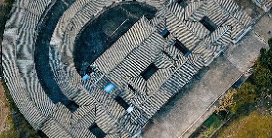
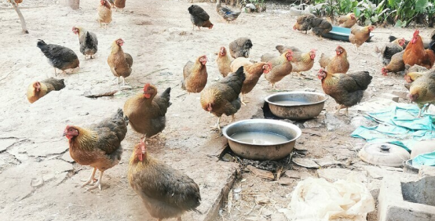
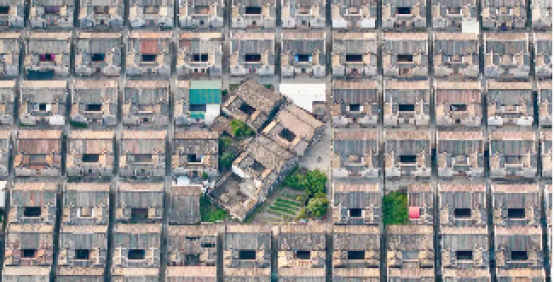
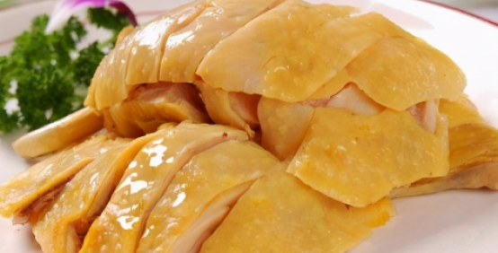
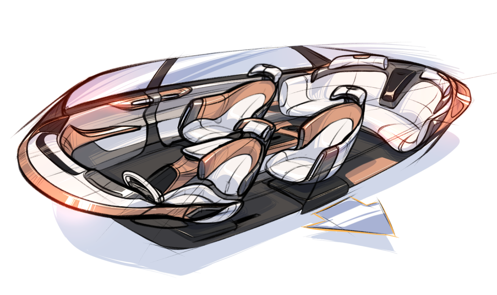
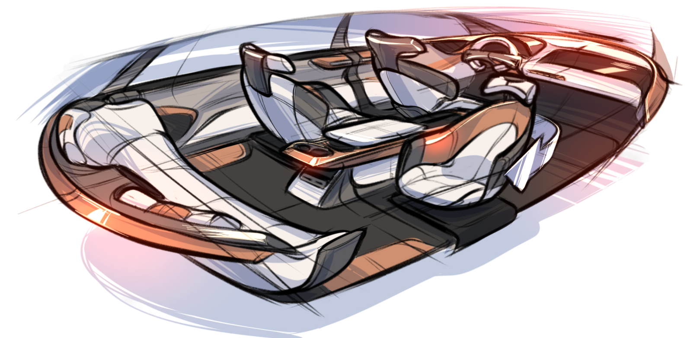
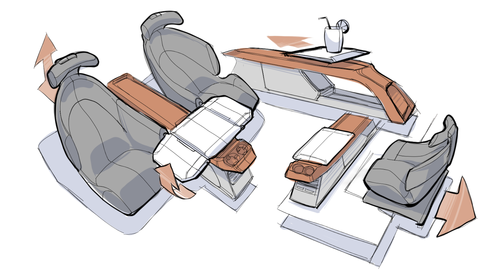

<section class="toyota-body-frame" data-slide-label="项目概述" data-design-width="1920" data-design-height="1080">

项目概述

校企合作命题创作

设计路径-  文化意向提炼与设计表达

该项目希望对广府岭南文化进行深入挖掘与重构，为家庭取向的SUV设计提供概念指导。

这是一个团队合作项目，我负责了前期的概念转化部分。

从岭南文化的部分切片进行切入，结合家庭取向这一角度，提取文化意向并解决家庭出行实际的痛点。

方法

目标

岭南文化挖掘

市场与目标用户

用户痛点洞察

家庭SUV设计策略

01

02

03

挖掘适用于家庭情境的文化意向

洞悉市场方向与定位目标用户

提供设计意境

功能考量

研究用户实际痛点寻找解决方案

设计概念

具体设计点

</section>
<section class="toyota-body-frame" data-slide-label="岭南文化挖掘" data-design-width="1920" data-design-height="1080">

岭南文化挖掘

维度一：宗族文化

维度二：饮食文化

01

岭南文化语境下，宗族是一个极具重量的概念。它代表着风雨无阻的团聚，代表着一方有难八方驰援的无私互助，代表着以远近血缘为线索的关系网。

基于宗族文化，岭南地区的建筑形式多以【聚合】【围圈】等方式出现。

对食物形式的追求可以被提炼为设计意象。

岭南人喜欢吃，更懂得如何吃。在物产丰腴的珠三角，吃是一种极致，体现于对于本味的追求；吃也是“叹”，一种闲适，一种惬意。

关键词

关键词

设计意象

设计意象

血缘关系

追求极致

互帮互助

关系紧密

向往惬意

镬耳屋街巷网  广府地区

色菜品的卖相要色泽靓丽

宗族矩阵  潮汕地区

香不同的菜品种类带有不同的特别的香气

围龙屋  客家地区

味对于食材的口感与其“本味”的追求

</section>
<section class="toyota-body-frame" data-slide-label="文化意象提取与衍化" data-design-width="1920" data-design-height="1080">

岭南文化挖掘

文化意象提取与衍化

岭南文化也应随时代的发展而继续衍变，在保留核心价值的同时形成更适合当代价值的文化表征。

基于多嫡系人口结构，导致极度强调地域与血缘关系

基于曾经较慢的生活节奏而提出，时间成本大

人口结构产生变化：

少子化与社会原子化

大宗族已越来越少

生活节奏随着工业化逐渐加快，对于既快又好——性价比的需求增加

强调人与人之间的互帮互助和建立紧密的关系纽带

强调对于饮食的极致追求，以及对于惬意氛围的营造

应当摒弃对地域与血缘的强调，转而将互帮互助、建立紧密关系推广至新的社会关系中

通过高新科技的赋能，使惬意的氛围更加易得

01

广府文化

曾经的面貌

现代面貌

衍化

维度一：

宗族文化

维度二：

饮食文化

新宗族精神

易得的闲适

</section>
<section class="toyota-body-frame" data-slide-label="市场与目标用户" data-design-width="1920" data-design-height="1080">

市场与目标用户

02

市场趋势

目标用户

年轻用户（35岁以下）比例变化

用户买车的目的分布

置换用户对SUV车型偏好

40.1%

短途自驾

长途自驾

购物

彰显个性品味

53.7%

46.5%

21.1%

12.5%

62.9%

+4.7%

+8%

+5.6%

-1.3%

-1.2%

+10.8%

35.4%

52.1%

数据来源：汽车之家调研数据［2022-2023］

年轻消费群体快速增长，自驾旅行出行场景成为了热门，SUV成为热门需求。用户对车生活的追求日益提高，自由惬意地享受生活成为越来越多人的目标。

新一代青年群体由于时代背景的不一样，青年群体之间的“兄弟姐妹”不一定是有血缘关系的家庭成员，他们彼此往往因为信任与互助而凝聚在了一起，成为彼此的“小亲人”。

老友记式群体

紧密的社会关系已经形成，但并未被正确关注

关键词

机会点

共同的价值取向

深度互助的社会关系

能够接受新型的社会关系

没有血缘关系

来自不同地区

</section>
<section class="toyota-body-frame" data-slide-label="用户痛点洞察" data-design-width="1920" data-design-height="1080">

用户痛点洞察

03

高频场景：自驾旅行

基于前文市场趋势中的高频场景进行用户旅程洞察

路途中长时间的乘坐与驾驶，乘客与驾驶员的休息、娱乐成为至关重要的场景

出发

抵达

数据来源：用户访谈

司机

乘客

“我长时间开车后会很想临时找一个安静、舒适的环境休息睡一会，但是现在的服务区都很吵闹，我基本只能眯一下眼睛；在车上睡觉又很不舒服，而且很热。”

“后排坐在中间会有点拥挤，而且无法舒服的休息。”

“在车上好无聊，要么睡觉要么玩手机。”

“长时间久坐屁股会很不舒服，但是驾驶过程中即使不舒服，我也不能随便活动自己的身体。”

“想临时处理一些工作，但是工作体验很糟糕。”

“睡觉的时候经常会落枕，无法以舒适的姿态休息。”

舒适的驾驶空间

更好的娱乐、休憩空间

</section>
<section class="toyota-body-frame" data-slide-label="家庭SUV设计策略" data-design-width="1920" data-design-height="1080">

家庭SUV设计策略

03

高频场景：自驾旅行

设计概念

设计框架

设计过程

基于前文市场趋势中的高频场景进行用户旅程洞察

出门在外，载具是年轻人的第二个家

提升乘员-司机关系的贯通、联结座舱

新宗族精神

易得的闲适

老友记式群体

舒适的驾驶空间

更好的娱乐、休憩空间

岭南文化重构

目标用户定位

用户痛点洞察
<ul data-node-id="279:2817" style="word-break:break-word;position:absolute;display:block;font-family:&#x27;PuHui&#x27;,&#x27;Noto SC&#x27;,sans-serif;line-height:0;left:833px;font-style:normal;font-size:20px;color:#171713;top:506px;width:252px;font-weight:400"><li style="list-style-type:disc;margin-inline-start:30px;">是年轻人与家人、朋友在外相处、放松、娱乐的独立空间</li></ul>
基于三个维度
<ul data-node-id="279:2819" style="word-break:break-word;position:absolute;display:block;font-family:&#x27;PuHui&#x27;,&#x27;Noto SC&#x27;,sans-serif;line-height:0;left:833px;font-style:normal;font-size:20px;color:#171713;top:599px;width:252px;font-weight:400"><li style="list-style-type:disc;margin-inline-start:30px;">是年轻人户外与居家场景的过渡地带、临时停靠的港湾</li></ul><ul data-node-id="279:2820" style="word-break:break-word;position:absolute;display:block;font-family:&#x27;PuHui&#x27;,&#x27;Noto SC&#x27;,sans-serif;line-height:0;left:833px;font-style:normal;font-size:20px;color:#171713;top:692px;width:252px;font-weight:400"><li style="list-style-type:disc;margin-inline-start:30px;">是让人感觉闲适的、惬意的、放松的</li></ul>

司机-乘客

乘客-乘客

行为

情绪

空间

</section>
<section class="toyota-body-frame" data-slide-label="具体设计方案" data-design-width="1920" data-design-height="1080">

具体设计方案

在空间上贯通

在行为上联结

取消副驾座椅改为载物空间，以增大后方乘员空间

通过物理设计，提升司机与乘员的连接感

座舱中的围桌

通过平移扶手箱上小桌板

实现中台、围桌意象

贯通空间

</section>
<section class="toyota-body-frame" data-slide-label="座舱功能设计" data-design-width="1920" data-design-height="1080">

具体设计方案

扩大使用面积

可以链接乘员与司机，如帮司机开饮料等

扩大座舱空间，形成围桌感

折叠桌板

可平移桌板

可旋转移动二排座椅

</section>

